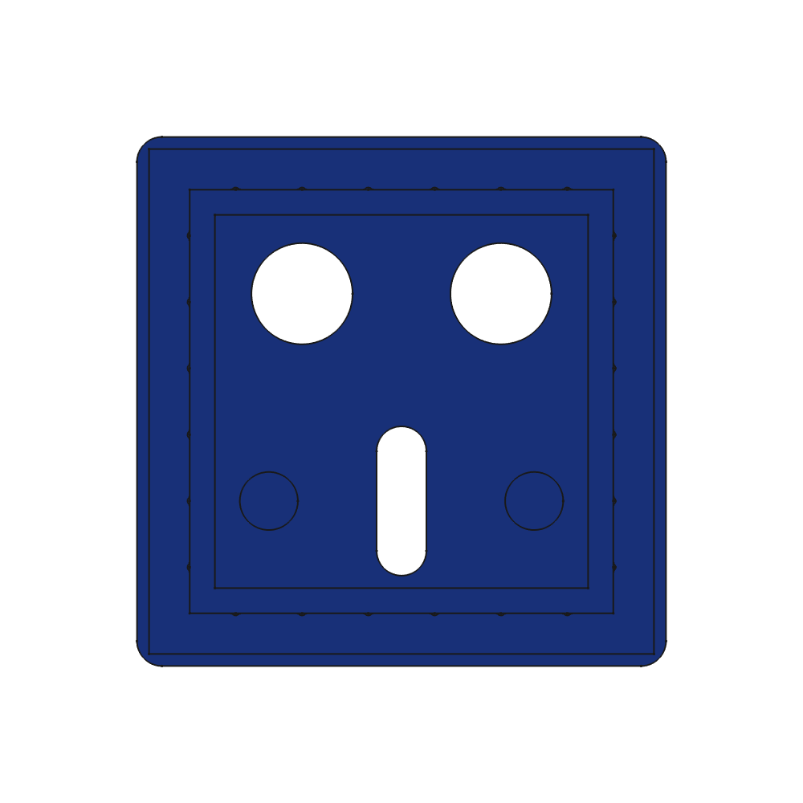
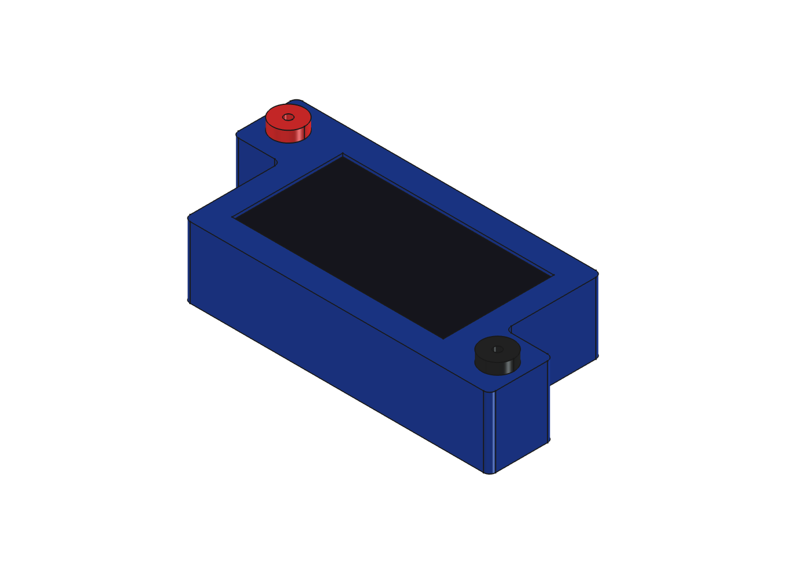
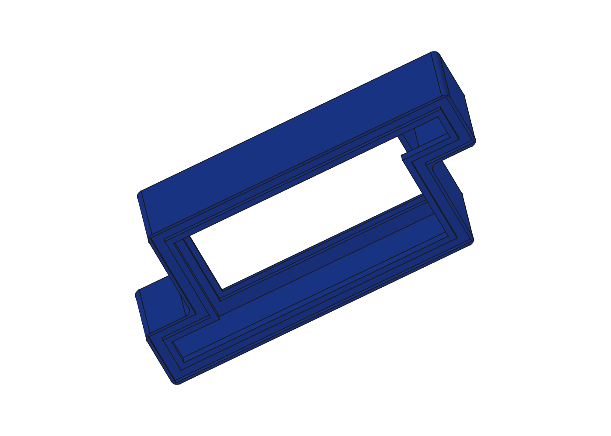

# Electronics STEM parts for kids

3D-printable modules for teaching kids the basics of electronics: a lamp, a solar panel and a coil, each in its own sturdy holder with proper 4 mm banana sockets.

The ready-made school experiment parts from China turned out to be too small and too fragile for children's hands, and they use tiny binding posts instead of real connectors. These are redrawn from scratch in FreeCAD: bigger, tougher, and built around standard 4 mm panel-mount banana sockets so normal lab leads plug straight in.

As a bonus, the modules are designed to click onto a LEGO-compatible baseplate, so a circuit stays put on the table.


## Modules

| Module | Files | Size (mm) | LEGO base | Status |
|---|---|---|---|---|
| E10 lamp holder | `Lamphouder_E10.*` | 63.8 × 63.8 × 35.2 | yes, 8 × 8 studs | drawn, not yet test-printed |
| Solar panel holder (LEGO) | `Zonnepaneel_Houder_Lego.*` | 175.8 × 79.8 × 35.2 | yes, 22 × 10 studs | drawn, not yet test-printed |
| Solar panel holder (plain) | `Zonnepaneel_Houder.*` | 166 × 76 × 34 | no | superseded by the LEGO version |
| Square coil with banana sockets | `Spoel_Electromagneet_Bananenbus.*` | 42 × 59 × 34 | not yet | drawn, not yet test-printed |
| Square coil, original small style | `Spoel_Electromagneet_Vierkant.FCStd`, `vierkante_spoel-Spoelkoker.step` | 35 × 40 × 10 | no | bobbin only, same size as the original part, no banana sockets |

The file names are Dutch: *lamphouder* = lamp holder, *zonnepaneel* = solar panel, *spoel* = coil, *houder* = holder, *bovenaanzicht* / *onderaanzicht* / *onderkant* = top view / bottom view / underside.

### E10 lamp holder

A square block with an E10 bulb base screwed on top and a red and a black banana socket in front of it.

| Top | Bottom |
|---|---|
|  |  |

- The bulb base is fixed from above with two small screws (2.9 mm self-tapping or M3, 6–8 mm long) into 2.5 mm pilot holes. Under each hole the top plate is thickened so the screw has 8 mm of material.
- The slot under the bulb base leaves room for its rivet and lets both wires drop into the box. One wire goes to the solder tag (centre contact), the other to the bracket itself, for example under a screw head.
- The block is square on purpose: the opening underneath is 45 × 45 mm, so you can reach the socket nuts and solder tags with your fingers.

### Solar panel holder

A frame for a 110 × 60 × 2 mm panel, with the two sockets on ears at opposite corners.

| Top | Underside |
|---|---|
|  |  |

- The panel goes in from underneath and rests against a 2.5 mm lip that covers its black border. Fix it with a few drops of glue.
- Known limitation: the sockets sit in the ears, where the opening straight below is only 13 mm wide. You have to reach them sideways through the large opening under the panel.

### Square coil

A square bobbin lying flat, with a terminal box beside it for the two sockets.


- Sockets are 19 mm apart, the standard spacing, so a dual banana plug fits.
- Two 2 mm slots in the wall between bobbin and box lead the wire ends to the solder tags.
- Drawn for 0.8 mm enamelled copper wire, 5 layers of 7 turns (about 35 turns, about 4 m of wire). That is only about 0.14 Ω, close to a short circuit: use a current-limited supply or a series resistor. At 2 A it gives roughly 2.5 mT in the centre.
- For induction experiments (moving a magnet through the coil) thinner wire with more turns works much better, for example 0.3 mm with 100+ turns.

## Parts to buy

| Part | Used in | Link |
|---|---|---|
| E10 bulb base with bracket (41 mm long, two screw holes) | lamp holder | https://amzn.eu/d/00OeK9Ge |
| E10 bulbs | lamp holder | https://amzn.eu/d/08Ck8Mhr |
| Dewin solar panel 6 V 1 W, 110 × 60 mm | solar panel holder | https://amzn.eu/d/03TlLYnt |
| 4 mm panel-mount banana sockets, red and black, 12 mm mounting hole (Cleqee, pack of 10) | all modules, two each | – |
| Screws 2.9 mm self-tapping or M3, 6–8 mm | lamp holder, two | – |
| Enamelled copper wire, 0.8 mm | coil | – |

## Printing

- Each module has a `.step` file of just the printable holder. The lamp holder also has `Lamphouder_E10-Pastest.step`, a 6 mm test slice for checking the LEGO fit. The `.FCStd` files also contain dummy sockets, nuts, the panel or bulb base, and a piece of baseplate for checking the fit; do not print those.
- Lamp holder and both solar panel holders: print **upside down** (top face on the bed). No support needed; the LEGO clamp rim blends into the wall at 45°.
- Coil: print upright. The upper bobbin flange and the roof of the terminal box need support or bridging.
- All parts are printed in Bambu Lab PLA Basic Blue, and the models and pictures use that colour (#0A2989). Any rigid filament works. The coil dissipates little power at sensible currents, but PLA softens around 60 °C, so do not leave a coil running at high current.

### LEGO fit

The underside has a channel that grips the outer row of studs between the outer wall and an inner rib. The channel is 5.0 mm wide for 4.8 mm studs, 0.1 mm clearance per side, because printed slots usually come out slightly tight.

A first print of the lamp holder with that plain channel slid over the studs but did not hold. The lamp holder therefore now has a tighter channel (0.05 mm clearance per side) plus one small crush rib per stud on the inner wall, each squeezing 0.2 mm into the stud, so it should stay on a vertical LEGO wall. The solar panel holder still has the plain 5.0 mm channel.

The fit depends on your printer. For the lamp holder, print `Lamphouder_E10-Pastest.step` first: it is only the bottom 6 mm and prints in minutes. If it is too loose or too tight, change `KLEMRIB_OVERMAAT` at the top of `lamphouder_e10.py` (larger is tighter) and re-run it. For the solar panel holder the value is `KLEM` (smaller is tighter).

## Measure before you print

Only some dimensions come from product listings; the rest are estimates from photos. Check these against the real parts:

| Dimension | Value in the model | Source |
|---|---|---|
| Socket mounting hole | 12.2 mm | listing: 12 mm, panel up to 6 mm thick |
| Socket depth below the top plate | 28 mm | estimated |
| Socket collar and nut diameter | 16 mm and 17 mm | estimated |
| Solar panel | 110 × 60 × 2 mm, 0.3 mm clearance all round | listing |
| E10 bracket length | 41 mm | listing |
| E10 bracket hole spacing | 32 mm centre to centre | estimated from the photo |

## Changing a design

Every module is generated by a FreeCAD Python script with all dimensions as named values at the top:

| Script | Generates |
|---|---|
| `lamphouder_e10.py` | E10 lamp holder (`LEGO = False` gives a plain open underside) |
| `zonnepaneel_houder_lego.py` | Solar panel holder with LEGO base |
| `zonnepaneel_houder.py` | Solar panel holder, plain |
| `spoel_bananenbus.py` | Square coil with banana sockets |

Edit the values, then run the script in FreeCAD (Macro → Macros…) or from a terminal:

```bash
/Applications/FreeCAD.app/Contents/MacOS/FreeCAD lamphouder_e10.py
```

It rewrites the `.FCStd`, the `.step` and the pictures next to the script. The shapes in the `.FCStd` files are plain solids without a feature history, so change dimensions in the script rather than in FreeCAD. Made with FreeCAD 1.1.

## Safety

These modules are for low-voltage experiments only: batteries, small solar panels and current-limited bench supplies. Never connect them to mains voltage.

## Licence

The designs, scripts and documentation in this repository are © Dave Willems and licensed under [Creative Commons Attribution-ShareAlike 4.0 International (CC BY-SA 4.0)](https://creativecommons.org/licenses/by-sa/4.0/). You may copy, print, change and share them, also commercially, as long as you give credit and share your changes under the same licence. The full text is in [LICENSE](LICENSE).

---

LEGO® is a trademark of the LEGO Group, which does not sponsor, authorise or endorse this project.
