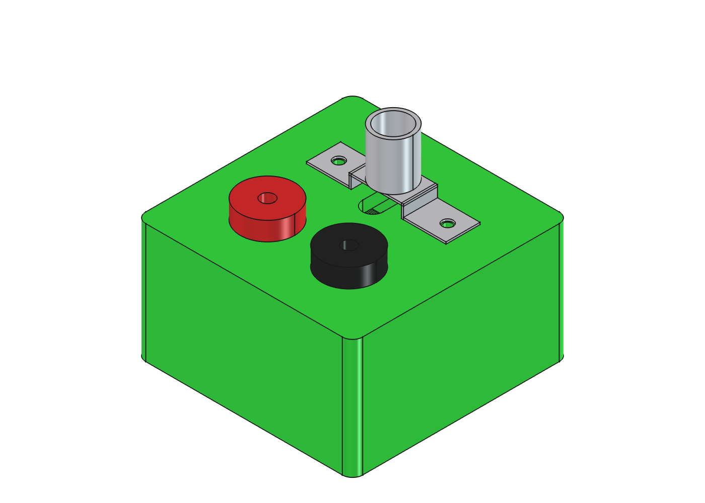
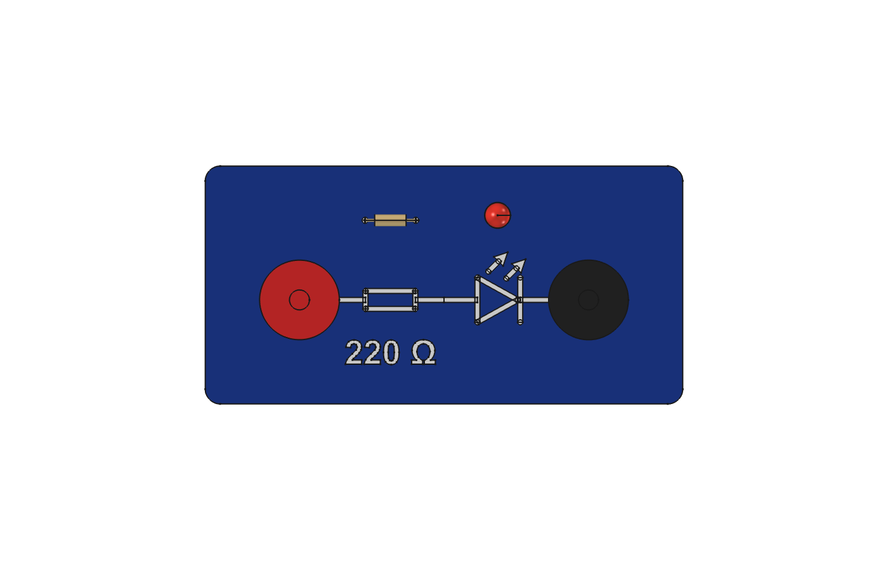
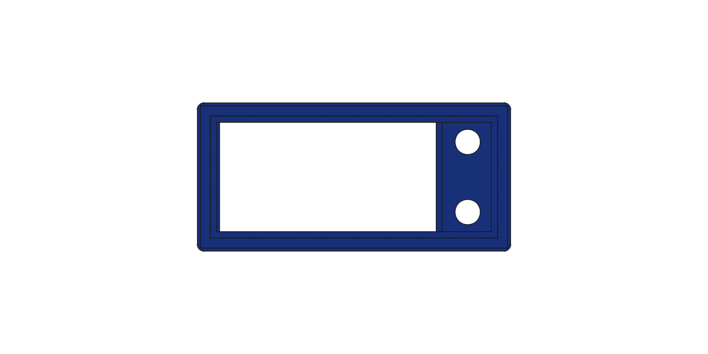
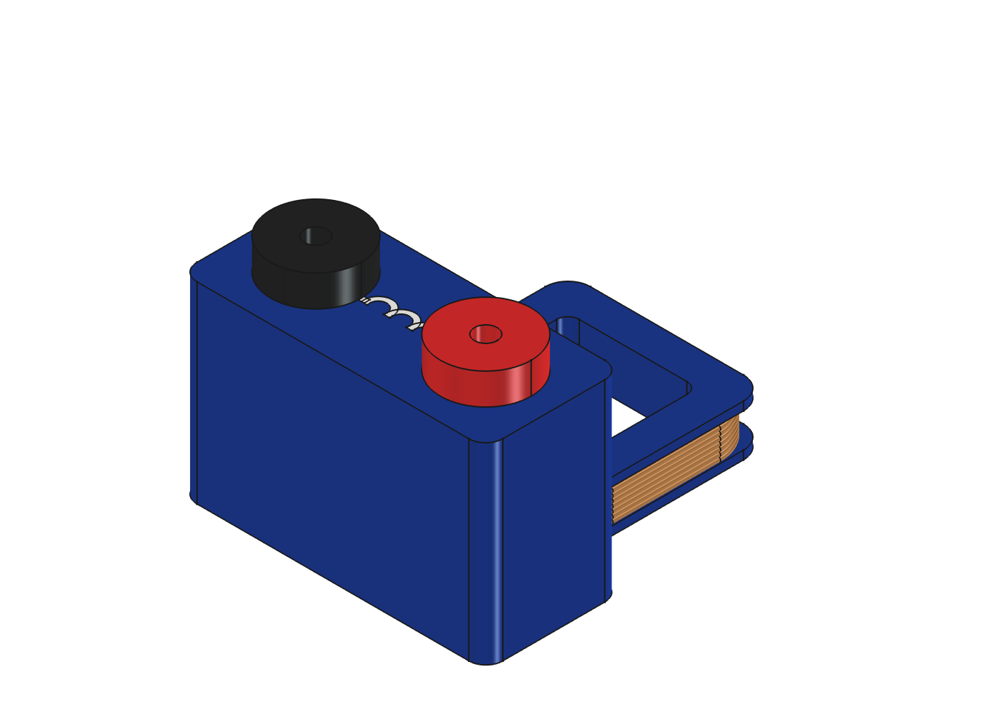
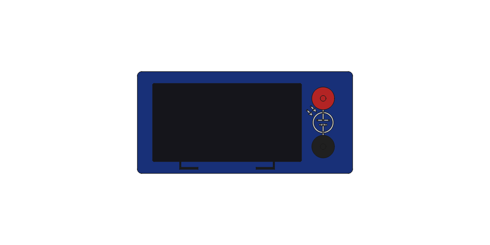

# Electronics STEM parts for kids

3D-printable modules for teaching kids the basics of electronics: a lamp, a solar panel and a coil, each in its own sturdy holder with proper 4 mm banana sockets.

The ready-made school experiment parts from China turned out to be too small and too fragile for children's hands, and they use tiny binding posts instead of real connectors. These are redrawn from scratch in FreeCAD: bigger, tougher, and built around standard 4 mm panel-mount banana sockets so normal lab leads plug straight in.

As a bonus, the modules are designed to click onto a LEGO-compatible baseplate, so a circuit stays put on the table.



## Modules

| Module | Files | Size (mm) | LEGO base | Status |
|---|---|---|---|---|
| E10 lamp holder | `Lamphouder_E10.*` | 63.8 × 63.8 × 35.2 | yes, 8 × 8 studs | drawn, not yet test-printed |
| 5 mm LED holder | `Ledhouder_5mm.*` | 95.8 × 47.8 × 35.2 | yes, 12 × 6 studs | drawn, not yet test-printed |
| Solar panel holder (LEGO) | `Zonnepaneel_Houder_Lego.*` | 151.8 × 71.8 × 35.2 | yes, 19 × 9 studs | drawn, not yet test-printed |
| Solar panel holder (plain) | `Zonnepaneel_Houder.*` | 166 × 76 × 34 | no | superseded by the LEGO version |
| Square coil with banana sockets | `Spoel_Electromagneet_Bananenbus.*` | 54 × 59 × 34 | not yet | drawn, not yet test-printed |
| Square coil, original small style | `Spoel_Electromagneet_Vierkant.FCStd`, `vierkante_spoel-Spoelkoker.step` | 35 × 40 × 10 | no | bobbin only, same size as the original part, no banana sockets |

The file names are Dutch: *lamphouder* = lamp holder, *zonnepaneel* = solar panel, *spoel* = coil, *houder* = holder, *bovenaanzicht* / *onderaanzicht* / *onderkant* = top view / bottom view / underside.

### E10 lamp holder

A square block with an E10 bulb base screwed on top and a red and a black banana socket in front of it.

| Top | Bottom |
|---|---|
|  |  |

- The bulb base is fixed from above with two small screws (2.9 mm self-tapping or M3, 6–8 mm long) into 2.5 mm pilot holes. Under each hole the top plate is thickened so the screw has 8 mm of material.
- The slot under the bulb base leaves room for its rivet and lets both wires drop into the box. One wire goes to the solder tag (centre contact), the other to the bracket itself, for example under a screw head.
- The block is square on purpose: the opening underneath is 45 × 45 mm, so you can reach the socket nuts and solder tags with your fingers.

### 5 mm LED holder

A box for a standard 5 mm LED with its series resistor, made to connect straight to a 5 V supply. The top shows the circuit between the two banana sockets: red (plus), resistor, LED, black (minus), with the resistor value printed under it.

| View | Top |
|---|---|
|  |  |

- The LED goes in from underneath through a 5.2 mm hole; its collar sits in a recess under the top plate, so the dome sticks out about 5 mm. A drop of glue behind it stops it being pushed back in.
- The resistor lies on top, behind its symbol, with its legs through two 1.2 mm holes 10.16 mm apart (the usual pitch for a 1/4 W resistor). Solder the wires to the legs inside the box.
- Resistor value for a red LED on 5 V: R = (5 V − 2.0 V) / I. 150 Ω gives 20 mA, the LED's rated maximum; **220 Ω** gives about 14 mA, still bright, and leaves margin for a supply slightly above 5 V or an LED with a lower forward voltage. The box says 220 Ω; change `WEERSTAND_TEKST` in `ledhouder.py` for another value or LED colour.
- Wiring: red socket → resistor → long LED leg (anode); short LED leg (cathode) → black socket. The triangle in the symbol points the same way.
- Both socket nuts sit straight above the open underside (77 × 29 mm).

### Solar panel holder

A long rectangle for a 110 × 60 × 3 mm panel with rounded corners, with the two sockets side by side next to the panel. The older plain version (no LEGO base) still has the sockets on ears at opposite corners and a pocket for a 2 mm panel.

| Top | Underside |
|---|---|
|  |  |

- The panel goes in from underneath and rests against a 2.5 mm lip that covers its black border. In the LEGO version it snaps in: six small wedge-shaped catches on the long sides of the pocket let the panel click past and then sit under its back, so no glue is needed. The pocket and window have rounded corners to match the panel. The snap fit depends on the real panel size and has not been confirmed with a print; a drop of glue still works as a backup. The plain version has a square pocket and needs glue.
- Both socket holes sit straight above the open underside, clear of the LEGO clamp rim, so the sockets and nuts can be fitted from below. An earlier version with the sockets on ears made that impossible.

### Square coil

A square bobbin lying flat, with a terminal box beside it for the two sockets.



- Sockets are 30 mm apart, to leave room for the coil symbol between them. (An earlier version used the standard 19 mm spacing for dual banana plugs.)
- Two 2 mm slots in the wall between bobbin and box lead the wire ends to the solder tags.
- Drawn for 0.8 mm enamelled copper wire, 5 layers of 7 turns (about 35 turns, about 4 m of wire). That is only about 0.14 Ω, close to a short circuit: use a current-limited supply or a series resistor. At 2 A it gives roughly 2.5 mT in the centre.
- For induction experiments (moving a magnet through the coil) thinner wire with more turns works much better, for example 0.3 mm with 100+ turns.

## Circuit symbols

Each box has the schematic symbol of its part between the two banana sockets, inlaid flush in the top surface for printing in white: a circle with a cross for the lamp, a resistor and a diode triangle with two arrows for the LED, a circle with a cell and two light arrows for the solar panel, and a row of bumps for the coil.

| Lamp | LED | Solar panel | Coil |
|---|---|---|---|
|  |  |  |  |

- The symbol is 0.4 mm deep, two layers at 0.2 mm layer height. Change `SYMBOOL_DIEPTE` in the script for another layer height, or set it to 0 for no symbol.
- Easiest way to print in two colours: open the `-Print.3mf` file of the module in OrcaSlicer or Bambu Studio. It holds one object with two parts (holder on filament 4 = blue, symbol on filament 2 = white; change `FILAMENT_HOUDER` and `FILAMENT_SYMBOOL` in `maak_3mf.py` for another AMS layout), already turned into its print position. Do not load the holder and the symbol as two separate objects: the slicer then reports g-code path conflicts, because they occupy the same space.
- The `.step` file of each of these modules also contains both bodies, for use in other software. `maak_3mf.py` regenerates the `-Print.3mf` files after a model script has been re-run.
- The lamp and solar panel holders print upside down, so the symbol is in the first two layers on the bed. The coil prints upright, so its symbol is in the last two layers.
- The symbols are small (the lamp symbol is 9 mm across, lines 1.0 to 1.2 mm wide) because the space between the sockets is limited. This has not been test-printed.
- The shapes come from `symbolen.py`, which the model scripts import; keep it in the same folder. The plain solar panel holder has no symbol.

## Parts to buy

| Part | Used in | Link |
|---|---|---|
| E10 bulb base with bracket (41 mm long, two screw holes) | lamp holder | https://amzn.eu/d/00OeK9Ge |
| E10 bulbs | lamp holder | https://amzn.eu/d/08Ck8Mhr |
| Red 5 mm LED and a 220 Ω 1/4 W resistor | LED holder | – |
| Dewin solar panel 6 V 1 W, 110 × 60 mm | solar panel holder | https://amzn.eu/d/03TlLYnt |
| 4 mm panel-mount banana sockets, red and black, 12 mm mounting hole (Cleqee, pack of 10) | all modules, two each | – |
| Screws 2.9 mm self-tapping or M3, 6–8 mm | lamp holder, two | – |
| Enamelled copper wire, 0.8 mm | coil | – |

## Printing

- Each module has a `.step` file of just the printable holder. The lamp holder also has `Lamphouder_E10-Pastest.step`, a 6 mm test slice for checking the LEGO fit. The `.FCStd` files also contain dummy sockets, nuts, the panel or bulb base, and a piece of baseplate for checking the fit; do not print those.
- Lamp holder and both solar panel holders: print **upside down** (top face on the bed). No support needed; the LEGO clamp rim blends into the wall at 45°.
- Coil: print upright. The upper bobbin flange and the roof of the terminal box need support or bridging.
- All parts are printed in Bambu Lab PLA Basic Blue, and the models and pictures use that colour (#0A2989). Any rigid filament works. The coil dissipates little power at sensible currents, but PLA softens around 60 °C, so do not leave a coil running at high current.

### LEGO fit

The underside has a channel that grips the outer row of studs between the outer wall and an inner rib. The channel leaves 0.05 mm clearance per side around a 4.8 mm stud, and small crush ribs on the inner wall each squeeze 0.2 mm into a stud.

A first print of the lamp holder with a plain, slightly wider channel slid over the studs but did not hold, which is why the ribs were added. The lamp holder has a rib at every stud along its sides (24 ribs). The LEGO solar panel holder is much larger and has one at every second stud (26 ribs), so it does not become too hard to press on. This rib fit has not been confirmed with a print yet.

The fit depends on your printer. Print the test slice first (`Lamphouder_E10-Pastest.step` or `Zonnepaneel_Houder_Lego-Pastest.step`): it is only the bottom 6 mm and prints quickly. If it is too loose or too tight, change `KLEMRIB_OVERMAAT` at the top of the script (larger is tighter) and re-run it. For the solar panel holder you can also change `KLEMRIB_OM_DE` (1 puts a rib at every stud).

## Measure before you print

Only some dimensions come from product listings; the rest are estimates from photos. Check these against the real parts:

| Dimension | Value in the model | Source |
|---|---|---|
| Socket mounting hole | 12.2 mm | listing: 12 mm, panel up to 6 mm thick |
| Socket depth below the top plate | 28 mm | estimated |
| Socket collar and nut diameter | 16 mm and 17 mm | estimated |
| Solar panel | 110 × 60 mm (listing), 3 mm thick (measured), 0.25 mm clearance all round; corner radius 4 mm estimated | listing and measurement |
| E10 bracket length | 41 mm | listing |
| E10 bracket hole spacing | 32 mm centre to centre | estimated from the photo |

## Changing a design

Every module is generated by a FreeCAD Python script with all dimensions as named values at the top:

| Script | Generates |
|---|---|
| `lamphouder_e10.py` | E10 lamp holder (`LEGO = False` gives a plain open underside) |
| `zonnepaneel_houder_lego.py` | Solar panel holder with LEGO base |
| `zonnepaneel_houder.py` | Solar panel holder, plain |
| `spoel_bananenbus.py` | Square coil with banana sockets |

Edit the values, then run the script in FreeCAD (Macro → Macros…) or from a terminal:

```bash
/Applications/FreeCAD.app/Contents/MacOS/FreeCAD lamphouder_e10.py
```

It rewrites the `.FCStd`, the `.step` and the pictures next to the script. The shapes in the `.FCStd` files are plain solids without a feature history, so change dimensions in the script rather than in FreeCAD. Made with FreeCAD 1.1.

## Safety

These modules are for low-voltage experiments only: batteries, small solar panels and current-limited bench supplies. Never connect them to mains voltage.

## Licence

The designs, scripts and documentation in this repository are © Dave Willems and licensed under [Creative Commons Attribution-ShareAlike 4.0 International (CC BY-SA 4.0)](https://creativecommons.org/licenses/by-sa/4.0/). You may copy, print, change and share them, also commercially, as long as you give credit and share your changes under the same licence. The full text is in [LICENSE](LICENSE).

---

LEGO® is a trademark of the LEGO Group, which does not sponsor, authorise or endorse this project.
