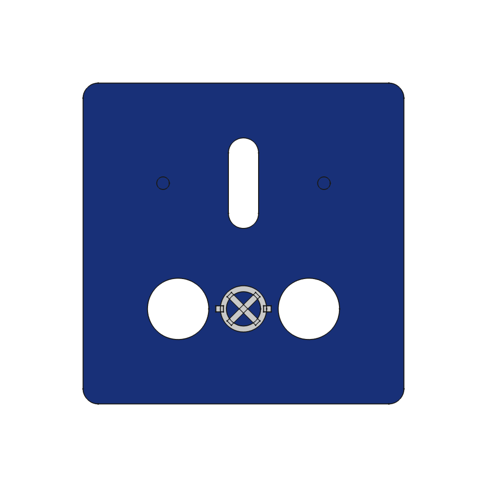
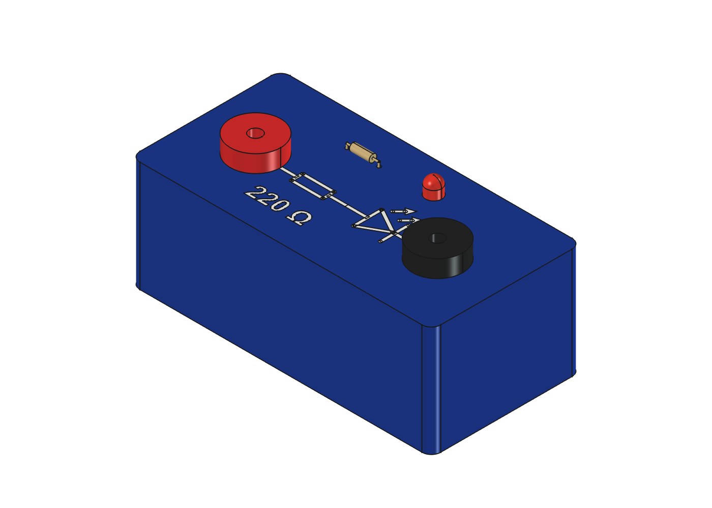
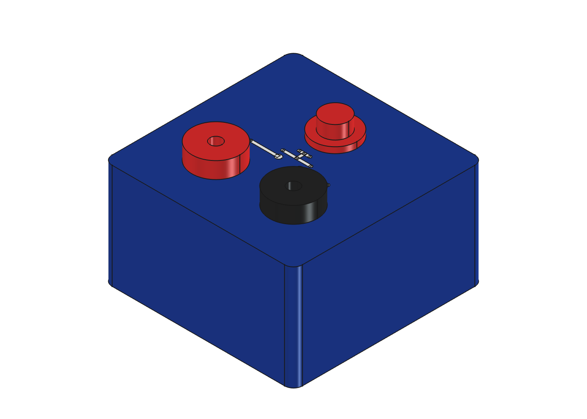
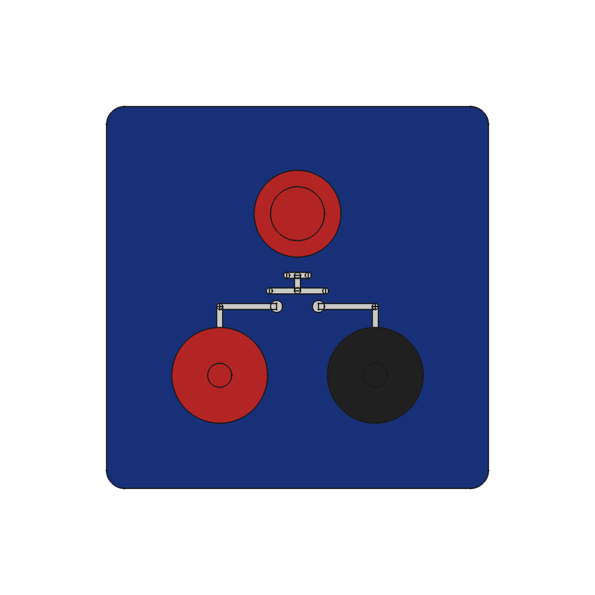
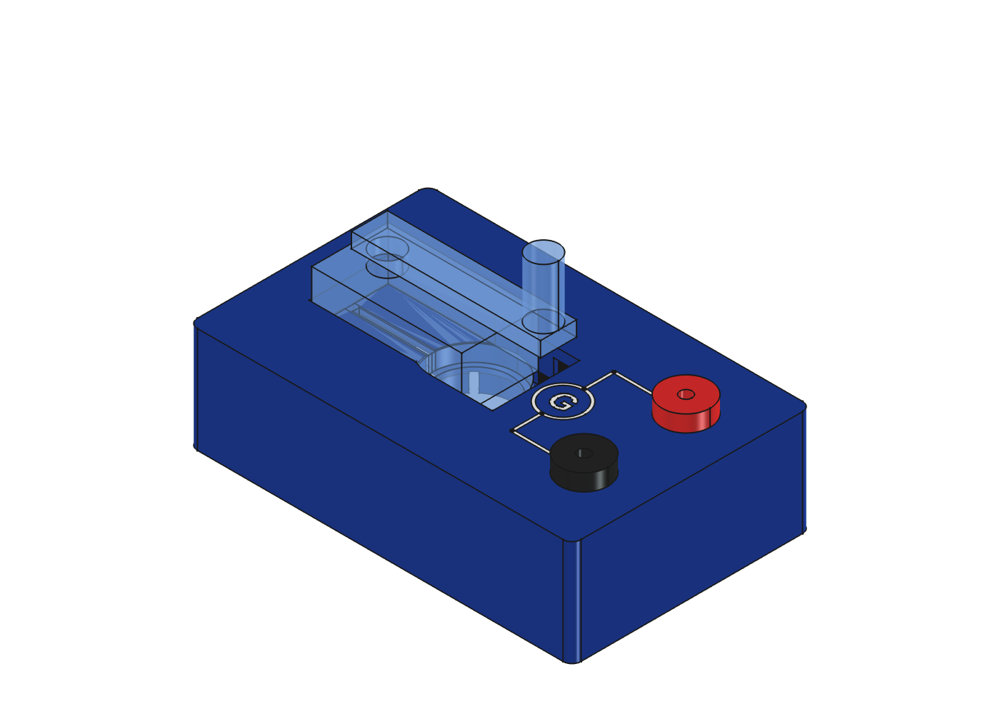
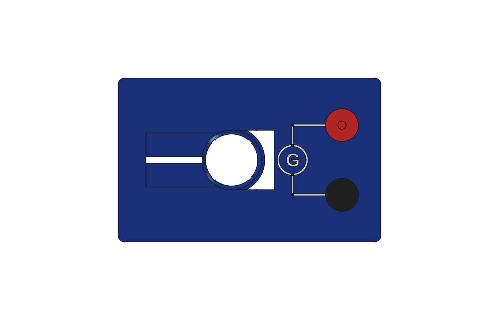
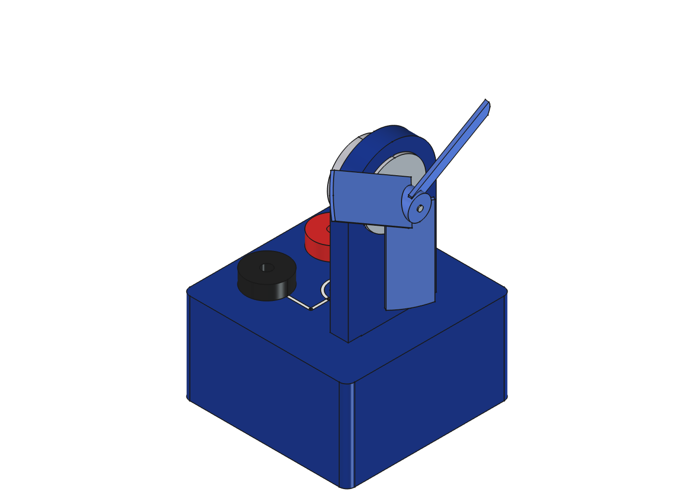
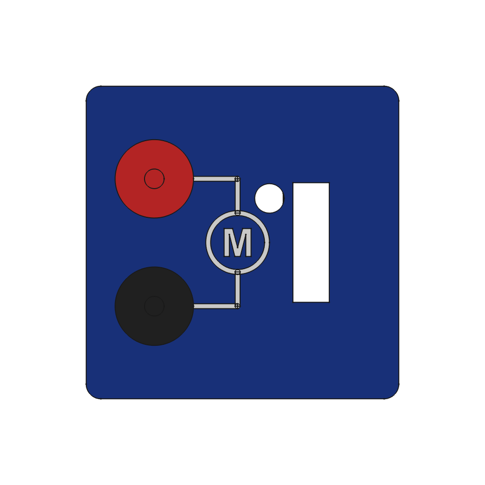

# Electronics STEM parts for kids

3D-printable modules for teaching kids the basics of electronics: a lamp, a solar panel and a coil, each in its own sturdy holder with proper 4 mm banana sockets.

The ready-made school experiment parts from China turned out to be too small and too fragile for children's hands, and they use tiny binding posts instead of real connectors. These are redrawn from scratch in FreeCAD: bigger, tougher, and built around standard 4 mm panel-mount banana sockets so normal lab leads plug straight in.

As a bonus, the modules are designed to click onto a LEGO-compatible baseplate, so a circuit stays put on the table.


## Modules

| Module | Files | Size (mm) | LEGO base | Status |
|---|---|---|---|---|
| E10 lamp holder | `Lamphouder_E10.*` | 63.8 × 63.8 × 35.2 | yes, 8 × 8 studs | drawn, not yet test-printed |
| 5 mm LED holder | `Ledhouder_5mm.*` | 95.8 × 47.8 × 35.2 | yes, 12 × 6 studs | drawn, not yet test-printed |
| Push button holder | `Drukknophouder.*` | 63.8 × 63.8 × 35.2 | yes, 8 × 8 studs | drawn, not yet test-printed |
| Hand crank generator | `Handgenerator.*` | 127.8 × 79.8 × 35.2 | yes, 16 × 10 studs | drawn, not yet test-printed |
| Motor with propeller | `Motorhouder.*`, `Propeller.*` | box 63.8 × 63.8 × 35.2, stand 69.5 high | yes, 8 × 8 studs | drawn, not yet test-printed |
| Solar panel holder (LEGO) | `Zonnepaneel_Houder_Lego.*` | 151.8 × 71.8 × 35.2 | yes, 19 × 9 studs | drawn, not yet test-printed |
| Solar panel holder (plain) | `Zonnepaneel_Houder.*` | 166 × 76 × 34 | no | superseded by the LEGO version |
| Square coil with banana sockets | `Spoel_Electromagneet_Bananenbus.*` | 54 × 59 × 34 | not yet | drawn, not yet test-printed |
| Square coil, original small style | `Spoel_Electromagneet_Vierkant.FCStd`, `vierkante_spoel-Spoelkoker.step` | 35 × 40 × 10 | no | bobbin only, same size as the original part, no banana sockets |

The file names are Dutch: *lamphouder* = lamp holder, *zonnepaneel* = solar panel, *spoel* = coil, *houder* = holder, *bovenaanzicht* / *onderaanzicht* / *onderkant* = top view / bottom view / underside.

### E10 lamp holder

A square block with an E10 bulb base screwed on top and a red and a black banana socket in front of it.

| Top | Bottom |
|---|---|
|  |  |

- The bulb base is fixed from above with two small screws (2.9 mm self-tapping or M3, 6–8 mm long) into 2.5 mm pilot holes. Under each hole the top plate is thickened so the screw has 8 mm of material.
- The slot under the bulb base leaves room for its rivet and lets both wires drop into the box. One wire goes to the solder tag (centre contact), the other to the bracket itself, for example under a screw head.
- The block is square on purpose: the opening underneath is 45 × 45 mm, so you can reach the socket nuts and solder tags with your fingers.

### 5 mm LED holder

A box for a standard 5 mm LED with its series resistor, made to connect straight to a 5 V supply. The top shows the circuit between the two banana sockets: red (plus), resistor, LED, black (minus), with the resistor value printed under it.

| View | Top |
|---|---|
|  |  |

- The LED goes in from underneath through a 5.2 mm hole; its collar sits in a recess under the top plate, so the dome sticks out about 5 mm. A drop of glue behind it stops it being pushed back in.
- The resistor lies on top, behind its symbol, with its legs through two 1.2 mm holes 10.16 mm apart (the usual pitch for a 1/4 W resistor). Solder the wires to the legs inside the box.
- Resistor value for a red LED on 5 V: R = (5 V − 2.0 V) / I. 150 Ω gives 20 mA, the LED's rated maximum; **220 Ω** gives about 14 mA, still bright, and leaves margin for a supply slightly above 5 V or an LED with a lower forward voltage. The box says 220 Ω; change `WEERSTAND_TEKST` in `ledhouder.py` for another value or LED colour.
- Wiring: red socket → resistor → long LED leg (anode); short LED leg (cathode) → black socket. The triangle in the symbol points the same way.
- Both socket nuts sit straight above the open underside (77 × 29 mm).

### Push button holder

A box the same size as the lamp holder for a 12 mm momentary push button (PBS-33B, normally open), with the push-button symbol drawn between the two banana sockets and the button.

| View | Top |
|---|---|
|  |  |

- The button hole is 11.6 mm. The button only allows a 3 mm panel, so the top plate is thinned to 2.4 mm under the button (a 20 mm recess from below) and its nut still fits on the 6 mm thread.
- The symbol shows two contacts with a bridge above them that the button pushes down; a line runs from each contact to a socket.
- The button and both socket nuts sit straight above the 45 × 45 mm opening underneath.

### Hand crank generator

A box for a small hand crank generator (blue gearbox with a motor). The gearbox stands in a well in the top with the motor pointing down into the box and the crank turning on top; the generator symbol (a circle with a G) sits next to the two banana sockets.

| View | Top |
|---|---|
|  |  |

- The gearbox block (50 × 25.5 × 17.8 mm) sits 8 mm deep in a well with 0.4 mm clearance per side, so it stays upright and cannot twist when you crank.
- The floor of the well is shaped to the underside of the gearbox: a round opening for the blue collar around the motor, a slot for the 2.2 mm rib that runs along the motor side, and below that a slitted collar around the 24.35 mm motor. A cable tie around that collar clamps the motor. The motor hangs about 3.5 mm past the end of the gearbox, so the well is open at that end.
- The box is wide (16 × 10 studs) so there is room for your fingers: 33 mm between the motor cup and the socket nuts, and both nuts sit well inside the opening underneath.
- The crank arm is about 52 mm long; the sockets are placed beyond its reach so plugged-in leads do not get hit.
- Measured on the real part: block size, collar height, motor diameter and length, how far the motor hangs past the end, rib thickness and crank axis position. Still estimated: the diameter of the blue collar (28 mm; the opening is 29 mm) and the height of the rib.
- Fast cranking can give well over 6 V, which is too much for the LED module with its 220 Ω resistor; crank gently or use the lamp.

### Motor with propeller

A box with the motor symbol (a circle with an M) and the two banana sockets, plus an upright stand that holds a Sol Expert SOL300 solar motor with its shaft horizontal, so the propeller blows air sideways.

| View | Top of the box |
|---|---|
|  |  |

- Three parts to print: the box (`Motorhouder-Print.3mf`, upside down with the white symbol), the stand (`Motorhouder_Standaard-Print.3mf`, lying flat on its side) and the propeller (`Propeller-Print.3mf`). None need support.
- The stand is a 7 mm plate with a 24.5 mm hole; three small ribs in the hole squeeze the 24.2 mm motor. A 24 × 7 mm tab under the stand goes 11 mm deep into a slot in the box; fix it with a drop of glue. The motor wires go down behind the stand through a 6 mm hole.
- The motor axis is 42 mm above the box, so a 70 mm propeller clears the top by 7 mm.
- The propeller (`propeller.py`) has three blades at 28°, 70 mm across, and a 2 mm hole that presses onto the motor shaft. The blades stand on their lower edge on the bed, so it prints without support.
- The SOL300 starts at 8 mA, so it runs from the solar panel, the hand crank generator, batteries or 5 V. Swapping the leads reverses the motor, and the propeller then blows the other way.
- Not yet measured on the real motor: its length and the length of its shaft.

### Solar panel holder

A long rectangle for a 110 × 60 × 3 mm panel, with the two sockets side by side next to the panel. The older plain version (no LEGO base) still has the sockets on ears at opposite corners and a pocket for a 2 mm panel.

| Top | Underside |
|---|---|
|  |  |

- The panel goes in from underneath and rests against a 2.5 mm lip that covers its black border. In the LEGO version it clicks in without glue: the back long side has three fixed hooks, the front long side has two catches on flexible tongues (the L-shaped slots you see next to the panel). Tilt the panel, tuck its back edge above the hooks, then press the front edge up until the tongues click. A first version with fixed catches on both sides was too stiff: the panel did not go in. The pocket is 110.7 × 60.8 mm for a panel measured at 110.0 × 60.1 mm, with square corners to match the panel. This fit has not been confirmed with a print; a drop of glue still works as a backup. The plain version has a square pocket and needs glue.
- Both socket holes sit straight above the open underside, clear of the LEGO clamp rim, so the sockets and nuts can be fitted from below. An earlier version with the sockets on ears made that impossible.

### Square coil

A square bobbin lying flat, with a terminal box beside it for the two sockets.


- Sockets are 30 mm apart, to leave room for the coil symbol between them. (An earlier version used the standard 19 mm spacing for dual banana plugs.)
- Two 2 mm slots in the wall between bobbin and box lead the wire ends to the solder tags.
- Drawn for 0.8 mm enamelled copper wire, 5 layers of 7 turns (about 35 turns, about 4 m of wire). That is only about 0.14 Ω, close to a short circuit: use a current-limited supply or a series resistor. At 2 A it gives roughly 2.5 mT in the centre.
- For induction experiments (moving a magnet through the coil) thinner wire with more turns works much better, for example 0.3 mm with 100+ turns.

## Circuit symbols

Each box has the schematic symbol of its part between the two banana sockets, inlaid flush in the top surface for printing in white: a circle with a cross for the lamp, a resistor and a diode triangle with two arrows for the LED, a circle with an M for the motor, a circle with a cell and two light arrows for the solar panel, and a row of bumps for the coil.

| Lamp | LED | Solar panel | Coil |
|---|---|---|---|
|  |  |  |  |

- The symbol is 0.4 mm deep, two layers at 0.2 mm layer height. Change `SYMBOOL_DIEPTE` in the script for another layer height, or set it to 0 for no symbol.
- Easiest way to print in two colours: open the `-Print.3mf` file of the module in OrcaSlicer or Bambu Studio. It holds one object with two parts (holder on filament 4 = blue, symbol on filament 2 = white; change `FILAMENT_HOUDER` and `FILAMENT_SYMBOOL` in `maak_3mf.py` for another AMS layout), already turned into its print position. Do not load the holder and the symbol as two separate objects: the slicer then reports g-code path conflicts, because they occupy the same space.
- The `.step` file of each of these modules also contains both bodies, for use in other software. `maak_3mf.py` regenerates the `-Print.3mf` files after a model script has been re-run.
- The lamp and solar panel holders print upside down, so the symbol is in the first two layers on the bed. The coil prints upright, so its symbol is in the last two layers.
- The symbols are small (the lamp symbol is 9 mm across, lines 1.0 to 1.2 mm wide) because the space between the sockets is limited. This has not been test-printed.
- The shapes come from `symbolen.py`, which the model scripts import; keep it in the same folder. The plain solar panel holder has no symbol.

## Parts to buy

### Parts for the finished modules

| Part | Used in | Link |
|---|---|---|
| E10 bulb base with bracket (41 mm long, two screw holes) | lamp holder | https://amzn.eu/d/00OeK9Ge |
| E10 bulbs | lamp holder | https://amzn.eu/d/08Ck8Mhr |
| Red 5 mm LED and a 220 Ω 1/4 W resistor | LED holder | – |
| Sol Expert SOL300 solar motor (0.18–6 V, Ø 24.2 mm) | motor with propeller | https://www.conrad.nl/nl/p/sol-expert-90002l-sol300-solarmotor-1371438.html |
| Hand crank generator kit, 3–6 V | hand crank generator | https://amzn.eu/d/02YDxxYm |
| Red push button 12 mm, PBS-33B | push button holder | https://www.tinytronics.nl/nl/schakelaars/manuele-schakelaars/drukknoppen-en-schakelaars/rode-drukknop-12mm-reset-pbs-33b |
| Dewin solar panel 6 V 1 W, 110 × 60 mm | solar panel holder | https://amzn.eu/d/03TlLYnt |
| 4 mm panel-mount banana sockets, red and black, 12 mm mounting hole (Cleqee, pack of 10) | all modules, two each | – |
| Screws 2.9 mm self-tapping or M3, 6–8 mm | lamp holder, two | – |
| Enamelled copper wire, 0.8 mm | coil | – |

### Conrad order for the next modules

Ordered from Conrad for the planned dimmer, buzzer and light sensor modules, and for the motor module. Prices are what Conrad charged at the time of ordering, including VAT.

| Qty | Part | Conrad nr. | For | Unit price | Link |
|---|---|---|---|---|---|
| 1 | KYOCERA/AVX 3104604002 wirewound potentiometer, 100 Ω, 4 W, linear, 6 mm shaft, M10 thread | 2827033 | dimmer: dims the E10 lamp and, a little, the LED module (max 0.2 A) | € 12.99 | https://www.conrad.nl/nl/p/kyocera-avx-3104604002-3104604002-draadpotmeter-mono-4-w-100-1-stuk-s-2827033.html |
| 1 | Weltron WP20CS potentiometer, 1 kΩ, 0.4 W, linear, 60 mm shaft | 440864 | dimmer: dims the LED module (not for the lamp) | € 3.79 | https://www.conrad.nl/nl/p/weltron-002045038789-wp20cs-08-60f1-1k-20-lin-draaipotmeter-mono-0-4-w-1-k-1-stuk-s-440864.html |
| 5 | TRU COMPONENTS TC-9202060 active buzzer, 5 V DC, continuous tone, 85 dB, Ø 12 × 9 mm | 2300515 | buzzer module | € 0.97 | https://www.conrad.nl/nl/p/tru-components-tc-9202060-miniatuurzoemer-geluidsontwikkeling-85-db-spanning-5-v-dc-continu-1-stuk-s-2300515.html |
| 3 | LUNA Optoelectronics PDV-P8103 light dependent resistor (LDR), 16–33 kΩ at 10 lux | 1762910 | light sensor module | € 1.79 | https://www.conrad.nl/nl/p/luna-optoelectronics-pdv-p8103-fotoweerstand-ldr-tht-1-stuk-s-150-v-max-l-x-b-x-h-4-29-x-5-08-x-2-mm-1762910.html |
| 4 | Sol Expert SOL300 solar motor, 0.18–6 V, starts at 8 mA, Ø 24.2 mm | 1371438 | motor with propeller | € 2.29 | https://www.conrad.nl/nl/p/sol-expert-90002l-sol300-solarmotor-1371438.html |

Notes:
- The 100 Ω wirewound potentiometer can carry about 0.2 A (√(4 W / 100 Ω)). Use E10 bulbs of 0.2 A or less with it; for 0.3 A bulbs the 50 Ω version (Conrad 444782) is the safe choice.
- The buzzer is polarised: + to the red socket.
- Put the LDR in series with something (for example the LED module), never straight across the supply.

## Printing

- Each module has a `.step` file of just the printable holder. The lamp holder also has `Lamphouder_E10-Pastest.step`, a 6 mm test slice for checking the LEGO fit. The `.FCStd` files also contain dummy sockets, nuts, the panel or bulb base, and a piece of baseplate for checking the fit; do not print those.
- Lamp holder and both solar panel holders: print **upside down** (top face on the bed). No support needed; the LEGO clamp rim blends into the wall at 45°.
- Coil: print upright. The upper bobbin flange and the roof of the terminal box need support or bridging.
- All parts are printed in Bambu Lab PLA Basic Blue, and the models and pictures use that colour (#0A2989). Any rigid filament works. The coil dissipates little power at sensible currents, but PLA softens around 60 °C, so do not leave a coil running at high current.

### LEGO fit

The underside has a channel that grips the outer row of studs between the outer wall and an inner rib. The channel leaves 0.05 mm clearance per side around a 4.8 mm stud, and small crush ribs on the inner wall each squeeze 0.2 mm into a stud.

A first print of the lamp holder with a plain, slightly wider channel slid over the studs but did not hold, which is why the ribs were added. The lamp holder has a rib at every stud along its sides (24 ribs). The LEGO solar panel holder is much larger and has one at every second stud (26 ribs), so it does not become too hard to press on. This rib fit has not been confirmed with a print yet.

The fit depends on your printer. Print the test slice first (`Lamphouder_E10-Pastest.step` or `Zonnepaneel_Houder_Lego-Pastest.step`): it is only the bottom 6 mm and prints quickly. If it is too loose or too tight, change `KLEMRIB_OVERMAAT` at the top of the script (larger is tighter) and re-run it. For the solar panel holder you can also change `KLEMRIB_OM_DE` (1 puts a rib at every stud).

## Measure before you print

Only some dimensions come from product listings; the rest are estimates from photos. Check these against the real parts:

| Dimension | Value in the model | Source |
|---|---|---|
| Socket mounting hole | 12.2 mm | listing: 12 mm, panel up to 6 mm thick |
| Socket depth below the top plate | 28 mm | estimated |
| Socket collar and nut diameter | 16 mm and 17 mm | estimated |
| Solar panel | 110.0 × 60.1 × 3 mm, 0.35 mm clearance all round, square corners | measured |
| E10 bracket length | 41 mm | listing |
| E10 bracket hole spacing | 32 mm centre to centre | estimated from the photo |

## Changing a design

Every module is generated by a FreeCAD Python script with all dimensions as named values at the top:

| Script | Generates |
|---|---|
| `lamphouder_e10.py` | E10 lamp holder (`LEGO = False` gives a plain open underside) |
| `zonnepaneel_houder_lego.py` | Solar panel holder with LEGO base |
| `zonnepaneel_houder.py` | Solar panel holder, plain |
| `spoel_bananenbus.py` | Square coil with banana sockets |

Edit the values, then run the script in FreeCAD (Macro → Macros…) or from a terminal:

```bash
/Applications/FreeCAD.app/Contents/MacOS/FreeCAD lamphouder_e10.py
```

It rewrites the `.FCStd`, the `.step` and the pictures next to the script. The shapes in the `.FCStd` files are plain solids without a feature history, so change dimensions in the script rather than in FreeCAD. Made with FreeCAD 1.1.

## Safety

These modules are for low-voltage experiments only: batteries, small solar panels and current-limited bench supplies. Never connect them to mains voltage.

## Licence

The designs, scripts and documentation in this repository are © Dave Willems and licensed under [Creative Commons Attribution-ShareAlike 4.0 International (CC BY-SA 4.0)](https://creativecommons.org/licenses/by-sa/4.0/). You may copy, print, change and share them, also commercially, as long as you give credit and share your changes under the same licence. The full text is in [LICENSE](LICENSE).

---

LEGO® is a trademark of the LEGO Group, which does not sponsor, authorise or endorse this project.
